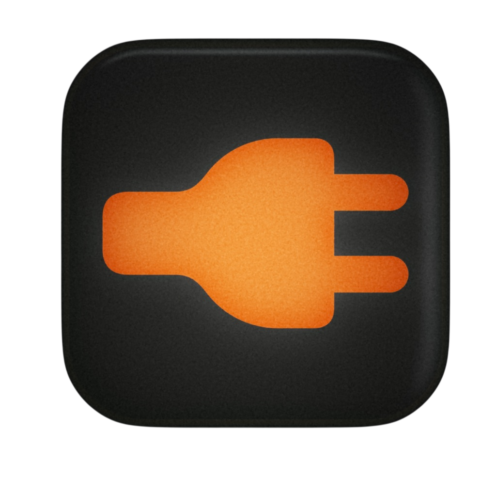
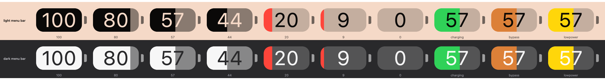
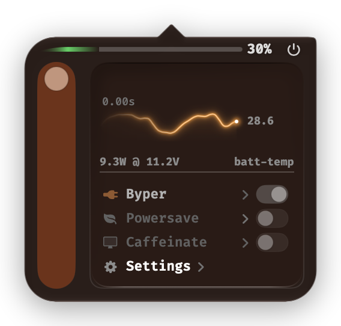

#  byper

[](https://github.com/Unnidentified/byper/actions/workflows/build.yml)
[](https://github.com/Unnidentified/byper/actions/workflows/ci.yml)

Charge bypass and a battery toolkit for Apple Silicon Macs (macOS 11+).

When you enable bypass, your battery is held at whatever level you want. Your computer, from this point forward, only sucks energy from the charger, meaning effective power draw from the battery is 0mA. You can choose between using the menu-bar app or the CLI utility from the terminal, which is much lighter on resources.

You don't need to build it locally, you can just click on actions > [build](#building), you'll get a `.pkg` and a `.dmg` inside a `.zip`



<table>
<tr>
<td width="480" align="center" valign="middle">

</td>
<td valign="middle">
<h3>Preview of the menu ui</h3>
<p>The slider on the left is the master switch. Slide it down and the rows dim and stop responding. Slide it back and your previous state returns. The graph is a fancy temperature graph, and below it, you can see your current charger specs.</p>
<p>Byper toggle enables bypass. It remembers the state from before it was unplugged.</p>
<p>Settings dropdown: bypass (on-connect/at-login/on-display-connect), and a logger that writes a CSV of power, temperature and charging history to your Desktop.</p>
</td>
</tr>
</table>

---

### Table of Contents

- [Building](#building)
- [Components](#components)
- [CLI Usage](#cli-usage)
- [How bypass works](#how-bypass-works)
- [Requirements](#requirements)
- [How to Install](#how-to-install)
- [How to Uninstall](#how-to-uninstall)
- [Project layout](#project-layout)
- [Credits](#credits)


## Building

1. Fork the repo.
1. In your forked repo, open the actions tab and run the Build workflow.
2. Leave `version` empty unless you want a specific label.
3. Tick `release` to publish a GitHub Release.
4. When the run finishes, grab the files from the run page or from releases.

On the other hand, to build it locally (faster), run:

```bash
make all              # bin/byper, bin/byper-mon.command, byper.app
./pkg/build_pkg.sh    # byper-installer.pkg + byper-installer.dmg
```


## Components

| Name | Explained | Notes |
|---|---|---|
| core | `byper` CLI | Lives at `/usr/local/bin/byper`. You can launch it through the terminal by running `byp` |
| menu bar | `byper.app` | SwiftUI app that can be used as a replacement to the stock battery menu. Native battery pill, colour change at different levels of percentages. Basically, it shows percentage, charging state and whether bypass is actually engaged |
| telemetry | SMC power rails | Per-rail wattage for SoC, DRAM, PMIC and DC-In, and individual pack cell voltages |
| bypass | Hardware charge bypass | System runs off the adapter at 0 mA net battery draw, battery held at whatever level you picked |
| powersave | Low Power Mode | Manual toggle, plus per-app auto-LPM while a designated app is frontmost. The manual switch wins over automation |
| caffeinate | Display and idle sleep hold | Manual toggle, or "On Bypass". Again, the manual switch wins |
| automations | Auto-bypass | On charger connect, at login, or on external display attach |
| logger | Session logger | Records CSV telemetry to your Desktop |
| shortcuts | Hotkey and App Intents | Global `⌘⌥B`, plus App Intents for bypass on/off/toggle on macOS 13+ |

The main slider on the left progressively dims and disables the menu rows (bypass, powersave, caffeinate, settings) as you slide it down. Slide it back to the top and your previous state comes back.

---

## CLI Usage

```bash
byper                  # Interactive real-time TUI monitor
byper on               # Engage charge bypass (plugged in)
byper off              # Resume standard charging
byper t                # Toggle bypass state
byper s                # One-line status summary
byper p                # Hardware power rails (SoC, DRAM, PMIC, cells)
byper json             # Telemetry snapshot formatted as JSON
byper mon              # Continuous timestamped stream (non-TTY friendly)
byper mon --export     # Write the session log to the Desktop
byper lpm on|off       # Low Power Mode
byper help             # Command usage
```

---

## How bypass works

macOS has no public API for "stop charging at the current level". Every surfaced knob (Optimized Charging, charge limits via `pmset`) is managed by PowerUIAgent, a system daemon whose in-memory charging state is neither persisted nor externally controllable.

So byper attaches to it:

1. It locates `PowerUIAgent` by PID via sysctl, no subprocess.
2. Writes a small lldb batch script to `/tmp`, serialized with a lock file.
3. Forks an orphaned worker that runs `lldb -p <pid> --batch` as root, calls the daemon's own smart-charge entry points to enter *Not Charging / hold* mode, then detaches. The parent returns immediately.
4. Confirms the result by polling SMC registers, never by trusting the injection.

The CLI never reads the SMC mode-of-operation value. It confirms a hold from four things at once: the adapter is attached, charging has stopped, the amperage is near zero, and either the not-charging reason carries the `0x01000000` flag or the pack is at 95 percent or above.

Direct SMC writes to the charge-limit keys were tested and are **rejected by the firmware**. `CHBI` writes don't stick, so injection is the only path that works.

Because the attach takes seconds, the UI's verify-poll gates truth and the engine retries on a 1.5s / 3.5s / 6s / 10s curve, capped at 45s. A toggle can therefore lag a tap by up to ~45s. That is expected, not a hang.

---

## Requirements

| Requirement | Why |
|---|---|
| apple silicon (M1-M4) | Builds target `arm64-apple-macos11.0`. Intel would need a universal2 build and untested SMC register maps |
| macOS 11 Big Sur or newer | Oldest release running on Apple Silicon. App Intents need macOS 13+. The Liquid Glass popover needs macOS 26; older systems get the previous dark solid shell |
| SIP debug flag disabled | Bypass attaches to `PowerUIAgent` with lldb, which stock SIP refuses |
| command line tools | The installer sets them up if missing |

Boot to recovery mode on macOS, open terminal and run:

```bash
csrutil enable --without debug
```

This only partially disables SIP. Filesystem, kernel-extension and NVRAM protections (the stuff that matter) stay on; only the debugger policy changes. Without it, `byper on` command fails with "Not allowed to attach" and bypass cannot work on that machine.

---

## How to install

To install:
```bash
curl -fsSL https://byper.org/install | bash
```

Or with Homebrew:
```bash
brew tap Unnidentified/byper https://github.com/Unnidentified/byper
brew install --cask byper
```

Or grab `byper-installer-<version>.pkg` from [Releases](https://github.com/Unnidentified/byper/releases/latest). In each case, your settings survive upgrades, and the installer sets up Command Line Tools if you don't have them and installs the SUID helper.


> Seeing "App is damaged and can't be opened"? That's macOS's gatekeeper being gatekeeper. To fix that issue, clear the quarantine attribute:
> ```bash
> xattr -cr /Applications/byper.app
> ```
> (or for a downloaded package: `xattr -c byper-installer.pkg`).

---

## How to uninstall

Run the .pkg and choose `Uninstall` (its postinstall removes every trace, including settings), or remove the paths in [Project layout](#project-layout) by hand and clear `~/Library/{Preferences/com.gefaass.byper.plist, Caches/com.gefaass.byper, Saved Application State/com.gefaass.byper.savedState}`.


---

`byper` must have `SUID` privileges in order to work, you can't just copy the .app to another computer and expect it to work. Spoiler: it won't, unless you reinstall it using the .pkg from the releases page. Check the permissions with:

```bash
ls -la /usr/local/bin/byper /Applications/byper.app/Contents/Resources/byper
```

---

## Project layout

```text
src/                    the engine: main.c (dispatcher + TUI), powerui.m (PowerUIAgent
                        bridge), smc.c (SMC registers), battery.c, power.c (rails + cells)
src/app/                the SwiftUI menu bar application and helper
pkg/                    package builder scripts (preinstall keeps settings;
                        uninstall-postinstall is a complete uninstaller)
completions/            Zsh and Bash shell completion
docs/                   architecture, install, troubleshooting, limitations, releasing, handoff
docs/images/            screenshots used by this README
.github/workflows/      build.yml (manual build, package, release), ci.yml (PR checks)
```

Installed paths:

| Where | Explained |
|---|---|
| `/usr/local/bin/byper` | SUID-root CLI (`chown root:wheel`, `chmod 4755`) |
| `/usr/local/bin/byp`, `/usr/local/bin/chbypass` | Symlinks to the same binary |
| `/usr/local/bin/byper-mon.command` (+ `byp-mon.command`) | Standalone monitor, from `install.sh` |
| `/usr/local/share/zsh/site-functions/_byper`, `_byp` | Zsh completions |
| `/usr/local/share/bash-completion/completions/byper`, `byp` | Bash completions |
| `/Applications/byper.app` | Menu bar app |

---

## Credits

| Project | Author | Link |
|---|---|---|
| FiraCode | Nikita Prokopov | [github.com/tonsky/FiraCode](https://github.com/tonsky/FiraCode) |
